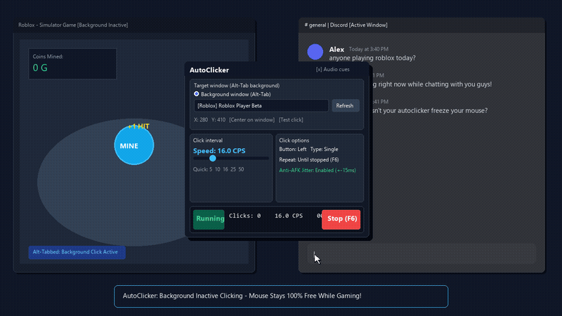

# AutoClicker

AutoClicker is an open-source automation utility for Windows, written in C# and WPF (.NET 6).

While traditional autoclickers require the target window to remain focused in the foreground, this project allows you to send clicks directly to inactive, background, or alt-tabbed windows (such as Roblox, Minecraft, browsers, or emulators) without moving your physical mouse cursor or stealing focus.



## Features

- Background clicking on inactive/alt-tabbed windows using native Win32 messages.
- Physical mouse cursor remains completely free while clicking runs in the background.
- Interactive window and coordinate picker (F7) to lock onto any target with a click.
- Millisecond-accurate multimedia timer (`timeBeginPeriod`) for stable intervals and high click rates (1 to 250+ CPS).
- Anti-detection jitter options: randomized delay (±ms) and coordinate scatter (±px) to avoid anti-AFK kicks.
- Standard foreground modes: click at current cursor location or fixed screen coordinates.
- Mouse options: Left, Right, or Middle button; Single, Double, or Triple click; custom button hold duration.
- Repeat settings: click indefinitely until stopped, or stop after a set number of clicks.
- Settings are automatically saved to `settings.json` and restored on startup.

## Comparison

| Feature | Standard AutoClickers | oriash93/AutoClicker | AutoClicker |
| :--- | :--- | :--- | :--- |
| Framework | C++ / WinForms | C# / WPF (.NET Framework) | C# / WPF (.NET 6) |
| Background window clicking | No | No | Yes (Win32 PostMessage) |
| Mouse cursor free during clicks | No (hijacked) | No (hijacked) | Yes |
| Target window and point picker | No | No | Yes (F7 overlay) |
| Anti-AFK jitter (delay + radius) | No | No | Yes |
| Live CPS and elapsed timer | No | No | Yes |
| Settings persistence | Sometimes | Yes (JSON) | Yes (JSON) |

## Background Clicking Setup (e.g. Roblox + Discord)

1. Open your target window (e.g. Roblox).
2. Click "Pick Window and Coordinate" in AutoClicker (or press F7).
3. Left-click anywhere on the target window to capture its handle and client coordinates.
4. Press F6 to start clicking.
5. Alt-Tab to Discord, a browser, or another app. The target window will continue receiving clicks in the background without interrupting your typing or moving your mouse cursor.

## Hotkeys

- F6: Start / Stop clicking toggle.
- F7: Open interactive target window and point picker.
- ESC: Cancel target picker.

## Download

Pre-compiled Windows binaries are located in the `dist` directory:

- `dist/AutoClicker.exe`: Standalone single-file executable. Runs on any Windows 10/11 system without requiring .NET runtime installed.
- `dist/framework-dependent/AutoClicker.exe`: Lightweight build (under 300 KB) for systems with the .NET 6 desktop runtime installed.

## Build from Source

Requirements: .NET 6.0 SDK or newer on Windows.

```bash
git clone https://github.com/ripmyy/AutoClicker.git
cd AutoClicker

# Build release
dotnet build AutoClicker.sln -c Release

# Publish standalone executable
dotnet publish src/AutoClicker/AutoClicker.csproj -c Release -r win-x64 -p:PublishSingleFile=true -p:IncludeNativeLibrariesForSelfExtract=true -p:EnableCompressionInSingleFile=true --self-contained true -o dist/standalone
```

You can also run `build.bat` to build and publish both versions automatically.

## License

MIT License. See LICENSE for details.
